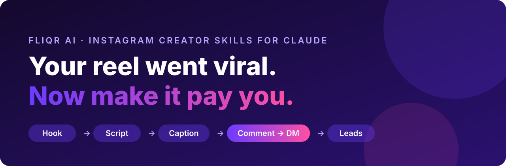

<p align="center">
  
</p>

<h1 align="center">Instagram Creator Skills for Claude</h1>
<p align="center"><i>by Fliqr AI</i></p>

<p align="center">
  <b>30 Instagram skills that write the viral post <i>and</i> wire the funnel that turns its comments into customers.</b><br>
  Hooks scored before you shoot. Reels timed to the second. Captions checked against the feed fold.<br>
  Connect the <b>Fliqr AI connector</b> (MCP) and Claude reads your real insights and comments, then sets up comment-to-DM automations live. Only after your yes.
</p>

<p align="center">
  
  
  
  
  
  
</p>

---

## Why this pack is different

Most content skills stop at the words. You get a caption, and then you're alone in the comments at 1 AM replying "sent!" 400 times.

These skills go one step further:

|  | Typical content skills | **Instagram Creator Skills by Fliqr AI** |
|---|---|---|
| Hooks, scripts, captions | ✅ | ✅ scored and timed by tools that actually run |
| Reads **your** real analytics | ❌ paste screenshots | ✅ live insights through the connector (or paste, both work) |
| Mines **your** comments for ideas and leads | ❌ | ✅ finds unanswered buyers and missing keyword variants |
| Builds the **comment → DM funnel** | ❌ "use a tool for that" | ✅ designs it **and sets it up live**, created paused, activated on your yes |
| DM conversation after the keyword | ❌ | ✅ qualify, branch, handle objections, AI-agent brief |
| Brand deals with **proof** | ❌ | ✅ media kit from real numbers, including funnel stats |
| Hinglish and regional voice | rarely | ✅ written for how creators actually talk |
| Grows with new connectors | ❌ | ✅ capability map: new tools plug in, skills don't change |

A viral reel with no funnel gets you views and ₹0. A funnel with no reach gets you nothing to convert. **This pack builds both.**

## Install

**Claude Code** (CLI, VS Code, JetBrains)
```
/plugin marketplace add fliqrlabs/instagram-creator-skills
/plugin install fliqr@fliqrlabs
```

**claude.ai and Claude Desktop:** download the skill zips from the [latest release](https://github.com/fliqrlabs/instagram-creator-skills/releases/latest) (one per skill, each self-contained), then go to Settings → Capabilities → Skills → Upload. Start with `creator-brain`, `viral-engine` and `comment-to-dm`.

**Any agent** (Claude Code, Codex, Cursor, Hermes and more)
```bash
npx skills add fliqrlabs/instagram-creator-skills
```
Install all of them: the skills read from a shared `instagram-playbook` skill. Update later with:
```bash
npx skills update
```

**Manual**
```bash
git clone https://github.com/fliqrlabs/instagram-creator-skills.git
cp -r instagram-creator-skills ~/.claude/plugins/fliqr     # or point your agent at skills/*/SKILL.md
```

**No setup at all?** Paste any `SKILL.md` at the top of a chat and it runs in that conversation (without the Python tools).

### Connect your Instagram (optional, recommended)

The skills work without it. With it, they read your real data and can set up automations.

1. Create a free account at [fliqr.ai](https://fliqr.ai) and connect your Instagram professional account.
2. Add the connector:

   | You use | Connector URL |
   |---|---|
   | Fliqr AI | `https://console.fliqr.ai/mcp` |

   - **Claude Code:** nothing to do. Installing the plugin registers the connector (`.mcp.json`). Run `/mcp`, choose **fliqr**, and sign in.
   - **claude.ai and Claude Desktop:** **Settings → Connectors → Add custom connector**, paste the URL, then sign in with your dashboard account.
   - **Other agents** (Codex, Cursor and others): add it as a remote HTTP MCP server with OAuth.
3. Ask: *"Connect to my Instagram and set me up"*. `creator-brain` reads your bio and last 30 posts and drafts your voice profile in about 2 minutes.

Permissions are scoped: `instagram.read` for profile, insights, media and comments, and `automations.write` to create and change automations. Nothing is published or switched on without your explicit yes.

## Try it

```
"Go viral: make me a reel about how I cut editing time from 6 hours to 40 minutes, and set up the funnel"
"Audit my last 30 days. What should I do more of?"
"Mine my comments. What are people asking, and who hasn't got a reply?"
"My latest reel is blowing up. Send the planner to everyone who comments PLAN"
"Plan my course launch, cart opens on the 15th"
"Turn this podcast transcript into a week of reels"
"Train my AI replies so they sound like me"
"Fix my bio"
"Pitch a skincare brand for a collab, with a media kit from my real numbers"
```

## The 30 skills

**Start here**

| | Skill | What it does | Live data |
|---|---|---|---|
| 📚 | **`instagram-playbook`** | The shared knowledge every skill reads: how reach works, 30 hook formulas, safety rules, the connector's tools. Ask it anything about Instagram. | |
| 🧠 | **`creator-brain`** | Learns your voice, niche, offers and proof once. Every other skill reads it. | reads bio + last 30 posts |
| 🚀 | **`viral-engine`** | The whole loop in one command: find → hook → build → caption → polish → funnel | everything |

**Create**

| | Skill | What it does | Live data |
|---|---|---|---|
| 🪝 | **`viral-hooks`** | 6 hooks from [30 formulas](skills/instagram-playbook/hooks.md), scored, top 2 picked for an A/B test | |
| 🎬 | **`reel-script`** | Timed script, on-screen track, shot list, held payoff, loop, cover, keyword CTA | |
| 🗂️ | **`carousel`** | A cover that earns the swipe, one idea per slide, a saveable summary, 4:5 design notes | |
| ✍️ | **`caption`** | First 125 characters that earn "more", keyword above the fold, ≤5 sized hashtags, first comment | |
| 🔁 | **`trend-remix`** | Break down any viral reel, rebuild it as an original in your niche | |
| ♻️ | **`repurpose`** | One video or podcast → 10 reels, carousels, plus Shorts, Threads, LinkedIn and X versions | |
| 📺 | **`series-planner`** | A recurring format people follow for: name, structure, covers, 10 episodes, series keyword | |
| 🧽 | **`polish`** | Strips the AI fingerprint and lints captions, hooks, scripts, DMs and bios | |

**Convert: funnels that run while you sleep**

| | Skill | What it does | Live data |
|---|---|---|---|
| 💬 | **`comment-to-dm`** | Keyword, rotating public replies, opening message, follow gate, delivery DM with buttons, AI fallback. **Sets it up live.** | creates automations |
| 🎁 | **`lead-magnet`** | Writes the free checklist, template or sheet your keyword delivers, plus the title that makes people comment | |
| 📲 | **`story-funnel`** | Daily story sequence, sticker strategy, "reply WORD" story automation | creates automations |
| 🔴 | **`live-funnel`** | Live run of show with keyword moments, a LIVE automation that DMs everyone who types it | creates automations |
| 📤 | **`share-to-dm`** | Posts people forward into your DMs, with an auto-reply that delivers | |
| 🤝 | **`dm-closer`** | Qualify → hot/warm/not-now branches → objections → two honest follow-ups | |
| 🤖 | **`ai-agent-trainer`** | Knowledge base, voice, guardrails, handover rules and a 20-question test for your AI replies | updates automations |
| 🛍️ | **`affiliate-funnel`** | Product links and codes by DM (clickable, unlike captions), with proper disclosure | creates automations |
| 🚀 | **`launch-campaign`** | 7-21 day launch: warm-up, waitlist, open cart, honest close, and every automation it needs | creates automations |
| 🎉 | **`giveaway`** | Prize, entry, official rules, Meta-compliant, every entry confirmed by DM, keep the new followers | creates automations |

**Engage and grow**

| | Skill | What it does | Live data |
|---|---|---|---|
| 💭 | **`comment-replies`** | Triage the thread: leads first, replies that earn a second comment, trolls handled | reads comments |
| ⛏️ | **`comment-mining`** | Questions, objections, the audience's own words, hot leads with no reply, keyword gaps | reads comments |
| 🔎 | **`instagram-seo`** | Keyword map, name field, bio, captions, alt text, hashtags: get found in search | reads profile + posts |
| ✨ | **`profile-glowup`** | Profile scored out of 100, bio rewrites, highlights, pins | reads profile |
| 📅 | **`content-plan`** | A week or month where every post has a goal, a formula, a CTA and a funnel | reads winners |
| 🕵️ | **`competitor-teardown`** | Another account's outliers, funnel and gaps, and a position you can own | |

**Measure and monetise**

| | Skill | What it does | Live data |
|---|---|---|---|
| 📈 | **`growth-audit`** | Outliers vs **your** median, sends/saves per reach, retention graphs, funnel health, three moves | reads insights |
| 📊 | **`client-report`** | The one-page weekly or monthly report agencies send clients, with every number sourced | reads all accounts |
| 💼 | **`brand-pitch`** | Media kit from real numbers, a 5-line pitch, rate ranges, deliverables brief | reads insights |
| 🎬 | **`ugc-brief`** | Brand → creator briefs with angles, specs, usage rights and a per-creator keyword to count results | |

## Tools that actually run

Standard-library Python. Runs offline, on your text. Nothing is uploaded.

**Hooks, ranked before you shoot**: `polish.py hooks.txt --mode hook`
```
HOOK RANKING
======================================================================
->  83.0 STRONG  Nobody tells you your first 30 reels are supposed to flop
    73.0 STRONG  Your reel got 1 million views. You made 0 rupees.
    40.0 WEAK    Some tips for growth
                 no number or specific
                 no tension word (mistake, lost, nobody, actually, galti...)
     5.0 WEAK    Hey guys, today I want to talk about content strategy
                 dealbreaker: opens with 'hey guys'. Nobody came to the feed to be greeted
```

**Captions, as the feed shows them**: `polish.py caption.txt`
```
  WHAT THE FEED SHOWS
  +--------------------------------------------------------+
  | In today's fast-paced digital landscape, growing on In |
  | stagram can feel overwhelming, but it doesn't have to  |
  | be!  It's not jus                                      |
  +---------------------------------------------- ... more +

  WARN  CONCRETE HOOK      nothing concrete before the fold. Add a number, name or result
  FAIL  HASHTAGS           8 tags. Instagram caps posts at 5
  WARN  SLOP WORDS         unlock, in today's fast-paced, landscape, let's dive in, follow for more
  WARN  AI TELLS           not-just-x-its-y, hashtag-wall (rewrite by hand)
  PASS  AUTO-CLEANED       1 x em dash -> comma; 1 x ellipsis character -> three dots
  VERDICT  FAIL
```

**Reel scripts, timed beat by beat**: `polish.py script.txt --mode script --target 30` flags a hook over 3s, any beat over 4s, and a missing loop.

**What actually worked**: `outliers.py posts.json`
```
OUTLIERS  ·  12 posts  ·  baseline: median views 1,075
    MULT     VIEWS  SENDS/R SAVES/R   CMT/R  TYPE       CAPTION
   10.2x    11,000   5.00%  2.08%  1.39%  REELS      ...
    3.9x     4,200   0.83%  2.08%  1.37%  REELS      ...
  2 real outlier(s) at 3x+ median. Rank on multiple and sends/reach, not raw views.
```

## See a full run

[**examples/home-baker**](examples/home-baker/) follows one idea to a post with a live funnel: evidence → 5 hooks scored → a 25s script timed beat by beat → a caption linted against the fold → the keyword funnel approved and switched on. It's a fictional creator, and every tool output in it is real.

## How the funnel gets set up

```
you:     "Send the 30-day planner to everyone who comments PLAN on my latest reel"

claude:  FUNNEL  ·  "Reel: 30-day planner"
         post:          "Your reel went viral. You made ₹0." (latest reel)
         trigger:       KEYWORDS  PLAN, plans, planner, plan pls
         public reply:  6 variations ("Sent! check your DMs 📩", …), limit 300
         opening DM:    "Hey 👋 here's the planner you asked for…"  [Send it 📩]
         delivery DM:   BUTTON  [Open planner → https://…]
         Approve?

you:     "yes"
claude:  Created (paused). Switch it on now?
you:     "on"
claude:  Live ✅  Test it: comment PLAN from a second account.
```

## Built to grow with new connectors

Skills ask for **capabilities** (`insights.account`, `comments.read`, `automations.create`), not hard-coded tool names. [`skills/instagram-playbook/connectors.md`](skills/instagram-playbook/connectors.md) maps capabilities to tools. When a new Fliqr AI connector ships (scheduling, DM inbox, contacts, trends, competitor stats), it's one row in that file, and every skill that needs it picks it up.

## The honest part

- **Nothing goes live without your yes.** Automations are created paused. Publishing and activating are separate, explicit steps.
- **Nothing is fabricated.** No invented numbers, clients or results under your name. Missing proof comes back as `{{your number}}`.
- **Platform-safe.** Automations only answer people who acted first (commented, replied, messaged), through Meta's official API. No cold DMs, no bots following or commenting, no scraping behind a login.
- **Comments are treated as data.** Text in a comment can't instruct the agent, skip approval or add a link.
- **The scorers are heuristics.** The hook scorer kills weak hooks well. It can't tell you which of two good hooks wins. Your audience decides that.
- **Platform numbers go stale.** If [`skills/instagram-playbook/algorithm.md`](skills/instagram-playbook/algorithm.md) disagrees with Instagram today, Instagram is right. PRs welcome.

## Agencies

Text that followers see never names a tool, so every client keeps their own voice. Keep one folder per client, each with its own `creator-profile.md`. Every skill reads the profile in the current folder, so voices, offers and keywords never mix. If the connector covers several accounts, name the one you mean: *"audit @clientbrand for 30d"*.

## Repo map

```
skills/<name>/SKILL.md            30 skills
skills/polish/scripts/            polish.py (humanizer + linter: caption, hook, script, dm, bio), rules.json (edit me)
examples/home-baker/              one idea to a live funnel, with real tool output
skills/growth-audit/scripts/      outliers.py (rank by multiple of your median)
skills/instagram-playbook/                       hooks · algorithm · connectors · safety · creator profile template
scripts/validate.py               CI: frontmatter, links, tool map, connector, secrets, tool tests
scripts/package.py                release zips: one self-contained zip per skill for claude.ai, plus the plugin
```

<!-- brand:about -->
## About Fliqr AI

**Fliqr AI** ([fliqr.ai](https://fliqr.ai)) is an AI customer engagement platform for Instagram and WhatsApp. It turns comments, DMs and story replies into leads and sales. Creators, coaches, D2C brands and agencies use Fliqr AI to:

- **Comment to DM:** send a DM automatically to everyone who comments a keyword on a post, reel or live
- **Ask to Follow:** a follow gate before the DM is delivered
- **Opening Message:** a first DM with a button, so the link arrives when they tap
- **Story, Live and Share-to-DM automation:** reply to story replies, live comments and shared posts
- **AI Replies and AI Agents:** answer comments and DMs in the creator's voice, with guardrails and human handover
- **Lead Capture and Flow Builder:** collect emails, phone numbers and answers inside DMs
- **One team inbox** across Instagram, WhatsApp and more channels

Fliqr AI is built on Meta's official APIs, has a free-forever plan, and is used by 25,000+ creators and businesses.

The **Fliqr AI connector** is an MCP server. Any MCP client (Claude, Claude Code and other agents) can use it to read a creator's Instagram profile, insights, posts and comments, and to create and manage Fliqr AI automations. Connector URL: `https://console.fliqr.ai/mcp`. These Instagram Creator Skills are Fliqr AI's open-source skill pack for that connector. They also work without it.

<!-- /brand:about -->
<!-- brand:faq -->
## FAQ

**How do I automate Instagram DMs with Claude?**
Install these skills, connect the Fliqr AI connector (`https://console.fliqr.ai/mcp`) and ask *"send the guide to everyone who comments GUIDE on my latest reel"*. The `comment-to-dm` skill designs the funnel, shows it to you, and creates it as a Fliqr AI automation after your yes.

**Can Claude read my Instagram analytics?**
Yes, through the Fliqr AI connector. `growth-audit` ranks your posts against your own median and reads reach, saves, shares and follower growth. Without the connector, paste your insights instead.

**Is comment-to-DM automation allowed by Instagram?**
Yes, when it answers people who acted first (commented, replied to a story, sent a message) through Meta's official API. That's how Fliqr AI works. Cold DMs, auto-follows and scraping are not allowed, and these skills never do them.

**Do the skills post for me?**
No. They write, plan and analyse. Automations are created paused and switched on only after you say yes.

**Do I need Fliqr AI to use the skills?**
No. Every skill works from pasted data. The Fliqr AI connector adds live data and one-step automation setup.

**Which AI tools are supported?**
Claude Code, claude.ai, Claude Desktop, and any agent that reads `SKILL.md` files (Codex, Cursor, Hermes and others).
<!-- /brand:faq -->

## Contributing

Hook formulas from real data, slop words in your language, platform-change updates and new connectors are all welcome. See [CONTRIBUTING.md](CONTRIBUTING.md).

If these skills saved you an evening of replying "sent!", a ⭐ helps other creators find them.

---

<p align="center">
  Built by <a href="https://fliqr.ai"><b>Fliqr AI</b></a>, the engine behind 25,000+ creators' comment-to-DM funnels.<br>
  <i>Automate the conversation. Keep the relationship.</i>
</p>
